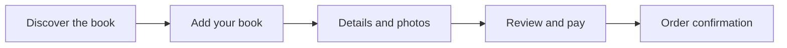

# First Pages — UX review from supplied screenshots

**Project:** Personalized children's book storefront  
**Evidence:** Three screenshots supplied for this portfolio case study (October 2026)  
**Review type:** Heuristic visual/interface review, **not** a usability study, analytics report, or verification of the current live site

## Source evidence and limitations

| Reference | What is visible | How to interpret it |
| --- | --- | --- |
| Capture A — mobile homepage | Promotional strip, brand header, opening hero, primary CTA, support/chat widget | A mobile interface capture. It demonstrates layout and content hierarchy at this captured viewport. |
| Capture B — checkout overview | Explicit heading **“Checkout — Before Redesign (Preview Only)”**; introductory messaging, sample book, summary panel, and three-stage journey | An **earlier checkout concept/preview**, not evidence of a currently published checkout. |
| Capture C — checkout payment section | Photo-selection control at the top edge, order summary, shipping line, total, payment options, payment fields, and privacy notice | A **checkout detail capture**; the screenshot does not establish its date, version, or live/draft status. |

The captures should not be presented as a verified chronological before/after comparison. Prices, offers, and shipping visible in these images are **snapshot-specific**, not verified current storefront settings.

## Primary problem statement

An unfamiliar shopper has to understand what a personalized book is, how the product is configured, what it costs, and whether checkout feels trustworthy. Any ambiguity or display issue can undermine confidence before purchase.

## Findings and recommendations

### 1. Mobile hero text breaks across words — high priority

**Observed:** The hero headline “Personalized Storybooks” appears at a very large size for the narrow screen and breaks inside words (“Personaliz / ed” and “Storybook / s”). Supporting text is also crowded.

**Why it matters:** The core product proposition becomes harder to read at precisely the point where first-time visitors are deciding whether they understand the offer. Irregular wrapping also creates an unfinished visual impression.

**Design response to explore:**
- Apply viewport-responsive font sizing and line height (for example via CSS `clamp()`).
- Avoid mid-word wrapping for the hero heading; allow natural word boundaries.
- Set a readable max-width for hero copy and preserve enough space around the primary CTA.
- Check narrow devices and longer text strings in the responsive QA pass.

**Validation:** Test at multiple narrow viewport widths and confirm that full words remain legible without horizontal overflow or clipping.

### 2. Chat widget competes with the hero — high priority

**Observed:** A dark support widget and separate chat launcher float over the right side of the mobile hero, obstructing supporting copy and competing for attention with the main “Create your book” CTA.

**Why it matters:** An assistive element should not hide the main explanation of the product or interfere with the primary conversion path.

**Design response to explore:**
- Use a compact, collapsed support launcher on small screens.
- Keep an appropriate inset from edges and avoid overlapping the main CTA.
- Make opening and dismissal predictable; verify keyboard and touch access.

**Validation:** Inspect the hero and checkout with the widget closed and open, including at 320–390 CSS-pixel widths.

### 3. The mobile promotional strip carries multiple messages — medium priority

**Observed:** The banner combines a discount offer/code and flat-rate shipping; on the capture, the message spans several lines above the logo.

**Why it matters:** Several competing messages above the fold can push the product explanation downward.

**Design response to explore:** Prioritize a single short promotional statement, or use a concise secondary line. Verify the promotion and shipping policy against the actual active storefront before publishing.

### 4. Checkout concept communicates the product and steps — strength to retain

**Observed in the preview only:** “Create their storybook” introduces the offer; the adjacent summary provides an example book, price, shipping line, and contact information. A three-stage journey is labeled “Add your book,” “Details & photos,” and “Review & pay.”

**Why it matters:** This structure helps make an unusual personalized purchase more predictable. It also supports progressive disclosure: shoppers can see how the process unfolds before committing to payment.

**Design response to retain/refine:** Keep the step labels, clear example labeling, accessible error/help text, and visible order context throughout the flow. Compare the preview with the final experience before making outcome claims.

### 5. Payment review exposes essential cost and method information — strength with opportunities

**Observed in the separate payment capture:** “Your Order,” “Cart Totals,” shipping, total, and multiple payment methods appear before a privacy notice. The displayed example shows two storybooks at $79.98, $10.00 shipping, and an $89.98 total.

**Why it matters:** Itemized costs and visible payment choices can reduce uncertainty. However, the captured payment area has considerable empty space and a far-right card input, so its reading order and responsive behavior warrant review.

**Design response to explore:**
- Keep the amount due and shipping terms legible near final confirmation.
- Tighten layout alignment around payment methods and card fields, especially at desktop-to-tablet breakpoints.
- Confirm form labels, focus states, errors, and final submission hierarchy are accessible.
- Audit mobile payment layout independently; no mobile checkout capture was supplied.

**Validation:** Task-based walkthroughs of personalization and checkout, form tab-order review, and optional future customer feedback or funnel metrics.

## Screenshot-derived checkout journey

The *preview's* labeled stages suggest the following conceptual flow, which should be validated against the actual live experience:

The order-confirmation step is a recommended journey endpoint, **not visible in the supplied captures**.

## UX fundamentals demonstrated

| Principle | Evidence or recommendation |
| --- | --- |
| **Visual hierarchy** | Fix headline wrap and make the primary CTA unmistakable on mobile. |
| **Clarity / recognition** | Explain personalization and label the example book as illustrative. |
| **System status / progress** | Use the three labeled stages to communicate where the shopper is in the process. |
| **Error prevention** | Clarify personalization inputs, shipping details, and payment requirements before submission. |
| **Consistency** | Align promotional messaging, product pricing, shipping language, and order totals throughout the journey. |
| **Accessibility** | Check responsive typography, touch targets, keyboard focus, input labels, and contrast. |
| **Trust** | Provide clear pricing, recognizable payment methods, support contact, and privacy information. |

## AI-assisted workflow context

Generative tools and agent-assisted workflows have been used during the broader project for exploration, content iteration, and implementation support. This screenshot review does **not** prove any specific change was generated by a particular tool. Design decisions, QA, and validation should be attributed separately in any final case study.

## Evidence to add next

1. A **current mobile homepage after fixes**, at the same or comparable viewport as Capture A.
2. A **current mobile checkout** showing personalization and payment without personal/customer data.
3. A **current desktop checkout** for an explicitly labeled comparison to the preview.
4. An optional annotated before/after comparison with dates and change descriptions.

**Privacy:** Before publishing original screenshots, remove browser account details, customer names/photos, genuine payment information, and any private order data. The sample book cover in Capture B depicts a child; use a cleared or redacted image for a public repository.

## Outcome reporting

This review documents visible problems and proposed solutions. No before/after conversion uplift, usability score, test participant results, or implementation completion is claimed without separate evidence.
